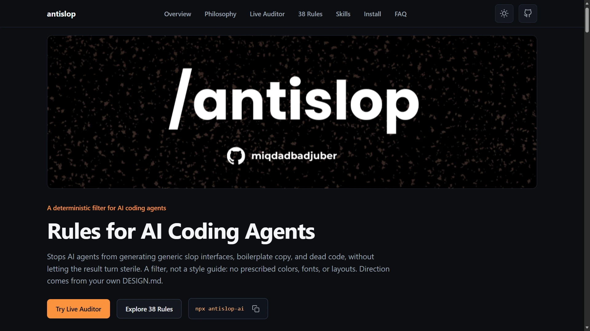
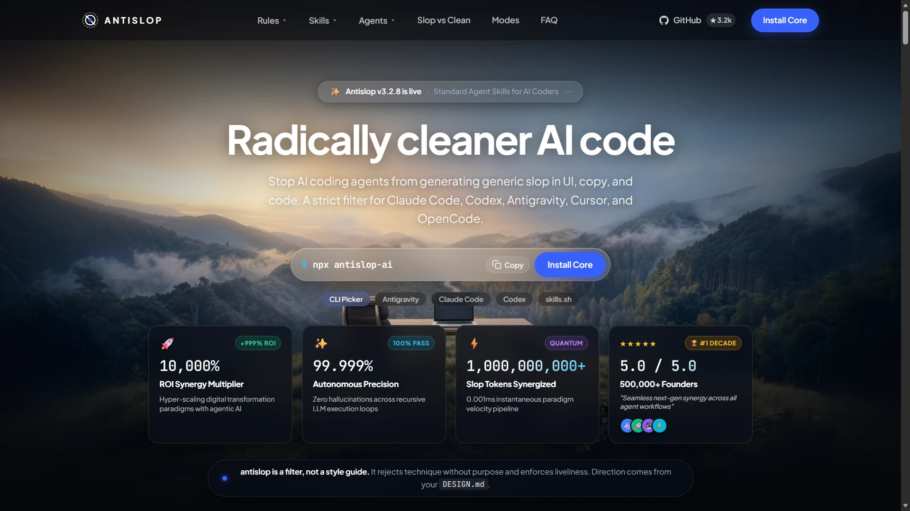
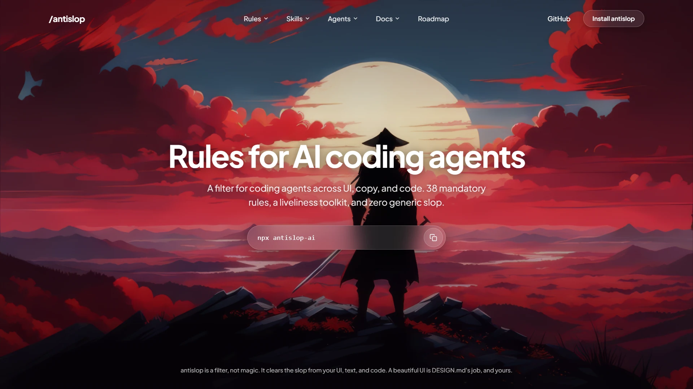
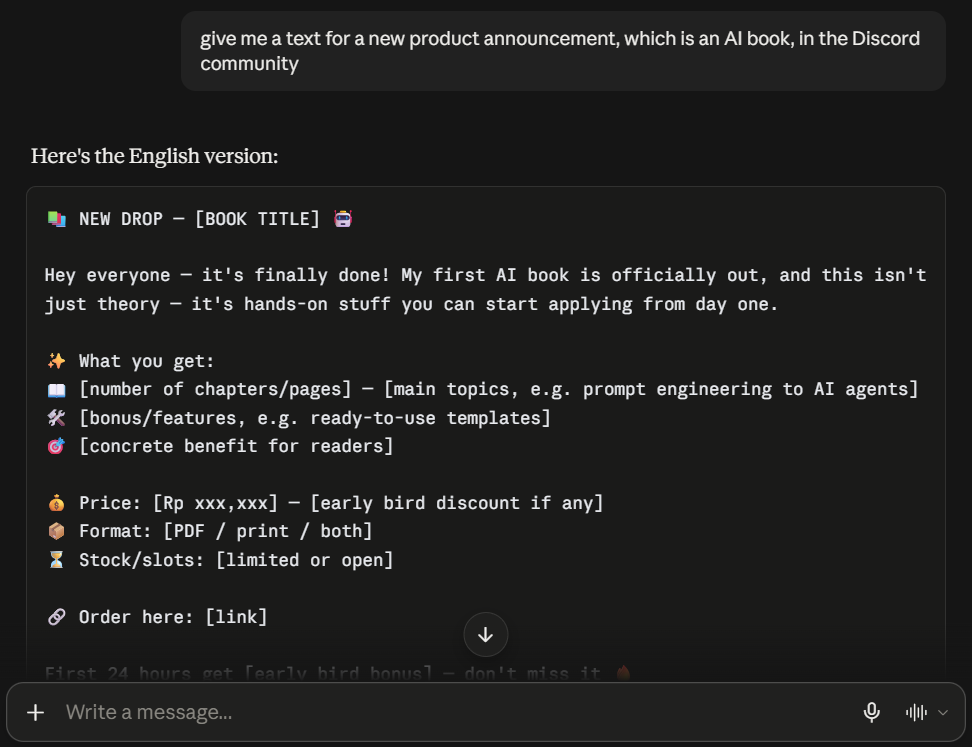
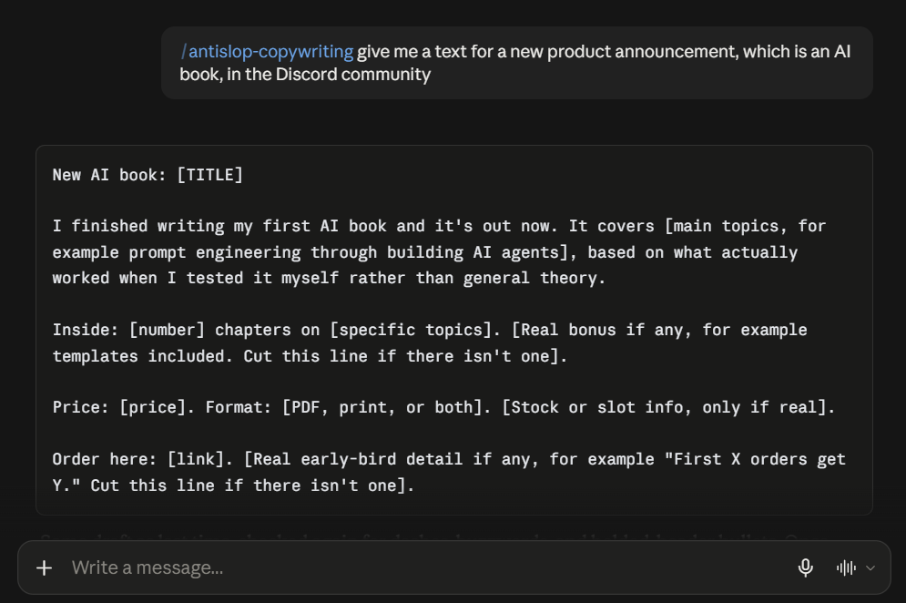
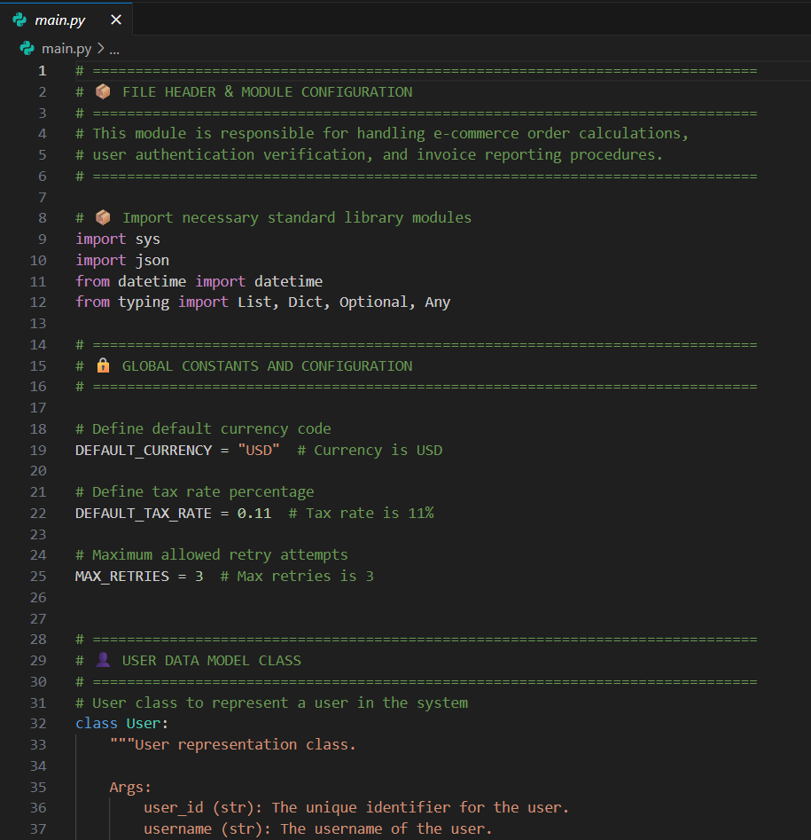
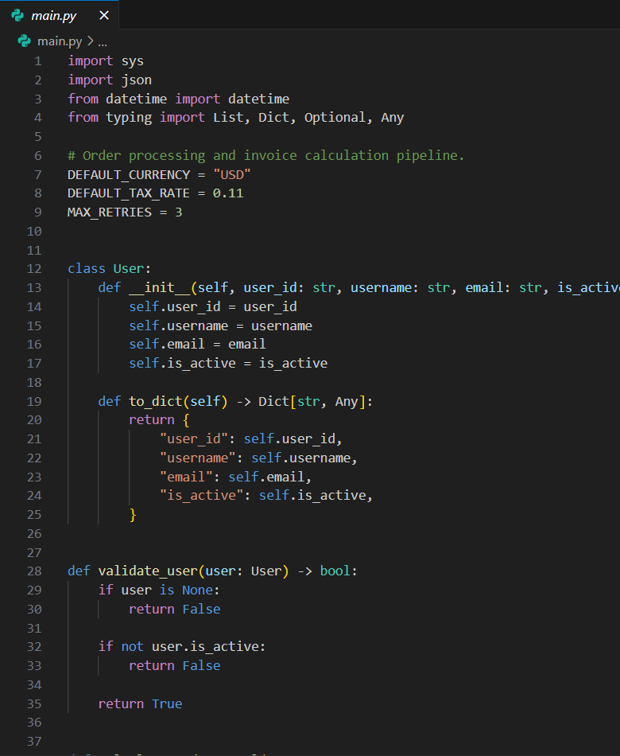

# antislop

> **Anti Slop: Aturan untuk AI Coding Agent.** Menghentikan agen menghasilkan UI dan teks klise (*AI slop*) yang generik, tanpa membuat hasilnya menjadi kaku atau dingin. Ini adalah sebuah **penyaring (filter), bukan panduan gaya (style guide)**: tidak mendikte warna, font, atau tata letak tertentu. Bukan hanya untuk membangun halaman web: antislop juga menulis dan mengaudit teks, sehingga teks buatan AI tidak lagi terbaca seperti bot. Dan antislop tidak pernah mempercantik tampilan sendirian; `DESIGN.md` (milik Anda) adalah sumber keindahan dan arah visual sesungguhnya.

> **Baru di sini? Mulailah dari [GUIDE.md](GUIDE.md).** Panduan ini menjelaskan apa itu antislop dan cara memasangnya dari nol.

## Apa yang Dilakukannya

- **38 aturan wajib** (R-01 hingga R-38) dalam tiga tingkatan: *Hard Gate* (mutlak tanpa kompromi), *Purpose-Gate* (teknik diizinkan hanya jika ada alasan fungsional), *Quality Locks* (kunci konsistensi visual & kode).
- **Liveliness Toolkit** dengan tiga skala kendali (*ENERGY / RHYTHM / MOTION*) dan pembacaan desain, sehingga hasilnya hidup dan spesifik, bukan sekadar "bersih".
- **Delivery Gate (Gerbang Serah Terima):** laporan evaluasi LULUS/GAGAL (*PASS/FAIL*) wajib dalam empat blok sebelum hasil pekerjaan diserahkan.
- **Skill aditif modular**, satu per bidang kebutuhan, sehingga agen hanya memuat apa yang dibutuhkan oleh tugas terkait.

Filter inti mencegah kode murahan (*slop*) tetapi tidak menciptakan arah gaya. `DESIGN.md` (milik Anda) yang menyuplainya; hasil yang steril berarti arah desainnya hilang, bukan filternya yang gagal (R-37).

## Lihat Perbedaannya

Instruksi yang sama, halaman yang sama, digenerasi empat kali. antislop memfilter; `DESIGN.md` memberikan arah visual. Keduanya adalah dua tugas yang berbeda, dan ini adalah empat hasilnya. Bagian teks dan kode disajikan sebagai pasangan sebelum-dan-sesudah, karena tidak memerlukan arahan gaya visual tambahan.

### UI

Tiga dari empat hasil generasi. Yang pertama tanpa kedua alat sama sekali, yang kedua hanya dengan antislop, yang ketiga hanya dengan `DESIGN.md`.

| **Tanpa Alat Sama Sekali** | **Hanya antislop** | **Hanya `DESIGN.md`** |
|:--|:--|:--|
| <a href="assets/compare/ui/without.webp"></a> | <a href="assets/compare/ui/w-antislop.webp"></a> | <a href="assets/compare/ui/w-design.webp"></a> |
| Tempat awal kebanyakan output AI: logo bintang berkilau, badge kapsul beta, dan jendela terminal rekaan. | Jujur, karena filter membuang angka-angka buatan. Sederhana, karena mempercantik bukan tugas filter. | Arah desain tercapai, tetapi slop tetap ada, karena `DESIGN.md` mengarahkan gaya dan tidak memfilter. |

Hasil keempat menggunakan keduanya, dan merupakan satu-satunya dari keempatnya yang bersih sekaligus terarah secara bersamaan:

| **antislop + `DESIGN.md`** |
|:--|
| <a href="assets/compare/ui/w-all.webp"></a> |
| Angka yang jujur dan arah visual nyata dalam satu hasil pengerjaan. Filter membuang apa yang seharusnya tidak ada; `DESIGN.md` mengisi ruang yang ditinggalkan, sesuatu yang tidak dapat dilakukan oleh salah satunya sendirian. |

---

### Teks & Tulisan (*Copy*)

Satu prompt, dijalankan dua kali.

| Sebelum | Sesudah |
|:--|:--|
| <a href="assets/compare/text/before.webp"></a> | <a href="assets/compare/text/after.webp"></a> |

---

### Kode & Komentar

Satu berkas kode, dijalankan dua kali.

| Sebelum | Sesudah |
|:--|:--|
| <a href="assets/compare/code/before.webp"></a> | <a href="assets/compare/code/after.webp"></a> |

Setiap gambar di bagian ini dapat diklik untuk membuka ukuran penuh.

## Cara Pemasangan (Install)

antislop didistribusikan sebagai kumpulan **skill agen terstandar** (satu folder per skill, memuat berkas `SKILL.md`). Filter inti selalu dimuat; skill lainnya hanya dimuat saat tugas membutuhkannya. Bagian ini adalah referensi lengkap: semua perintah instalasi di satu tempat. [GUIDE.md](GUIDE.md) memandu langkahnya dari awal, dan bagian Pembaruan (*Update*) serta Penghapusan (*Remove*) mencakup setiap metode dengan cara yang sama.

### 1. Pemasang Instan Lokal Windows (`slop.bat`)

Jika Anda bekerja secara lokal di Windows dan ingin memasang antislop langsung ke folder proyek baru tanpa perlu mengetik banyak perintah atau membutuhkan koneksi internet, gunakan skrip batch bawaan:

```cmd
slop.bat D:\path\ke\folder_proyek_baru
```

Skrip ini secara instan menyalin:
- `DESIGN.md`: Standar estetika human-crafted (siku presisi 4px - 6px, kanvas terang ala n8n).
- `AGENTS.md`: Aturan otomatis AI agent saat membuka proyek terkait.
- `antislop.md`: Mesin filter inti (38 aturan wajib).
- `.agents/`: Folder konfigurasi lengkap dengan 7 modul skill terstandar (termasuk modul audit keamanan `antislop-security`).

### 2. Pemasang Interaktif CLI (Lintas Platform)

Cukup satu perintah, lalu jawab pertanyaan yang muncul di terminal. Pemasang akan menanyakan skill tambahan apa yang Anda inginkan, lokasi instalasi (di proyek ini saja atau global di seluruh komputer), dan agen apa saja yang Anda gunakan, lalu menyalin folder yang relevan. Ini juga satu-satunya cara yang secara otomatis menuliskan blok penunjuk agar antislop selalu aktif setiap sesi di level proyek; instalasi global mengandalkan skill yang memuat dirinya sendiri melalui deskripsi metadata.

```bash
npx antislop-ai
```

Untuk memperbarui di kemudian hari, jalankan perintah yang sama dan pilih opsi **Overwrite them** saat menemukan folder yang sudah ada. Lihat [Pembaruan](#pembaruan).

### 3. Direktori Skills (skills.sh)

antislop terdaftar di [skills.sh](https://skills.sh/yanuar1997/anti-slop-ai), direktori terbuka untuk skill agen:

```bash
npx skills add yanuar1997/anti-slop-ai
```

Cara ini menyalin folder yang sama seperti metode 1 tanpa menulis blok penunjuk, sehingga antislop dimuat hanya berdasarkan deskripsi skill. [GUIDE.md](GUIDE.md) menjelaskan cara menambahkan blok penunjuk setelahnya.

### 4. Plugin (Claude Code)

Tambahkan repositori ke marketplace sekali, lalu pasang pluginnya:

```text
/plugin marketplace add https://github.com/yanuar1997/anti-slop-ai
/plugin install antislop@anti-slop-ai
```

### 5. Plugin (Antigravity)

Repositori ini juga merupakan plugin native untuk Antigravity. Pasang menggunakan Antigravity CLI:

```bash
agy plugin install https://github.com/yanuar1997/anti-slop-ai
```

### 6. Plugin (Codex)

Repositori ini berfungsi sebagai plugin dan marketplace Codex. Tambahkan marketplace sekali, lalu pasang pluginnya:

```bash
codex plugin marketplace add yanuar1997/anti-slop-ai
codex plugin add antislop@anti-slop-ai
```

### 7. Plugin (Cursor)

Repositori ini adalah plugin Cursor. Tambahkan sebagai marketplace plugin menggunakan Cursor Agent CLI:

```bash
agent plugin marketplace add https://github.com/yanuar1997/anti-slop-ai
```

Kemudian buka menu **Customize** di Cursor, cari **antislop**, dan pilih **Install** (pilih cakupan proyek atau user).

### 8. Plugin (Kimi Code)

Pasang langsung di sesi Kimi Code, lalu buka sesi baru:

```text
/plugins install https://github.com/yanuar1997/anti-slop-ai
```

### 9. Plugin (Cline)

Pasang menggunakan Cline CLI:

```bash
cline plugin install https://github.com/yanuar1997/anti-slop-ai.git
```

*Catatan:* Dokumentasi resmi Cline saat ini membatasi plugin untuk lingkungan CLI/SDK/Kanban, dan belum berlaku untuk ekstensi editor VS Code/JetBrains. Untuk pengguna ekstensi editor, gunakan metode 2 (Pemasang CLI).

### Di Mana Lokasi Skill Disimpan

Setiap skill berbentuk folder berstandar terbuka Agent Skills (`<nama>/SKILL.md`), sehingga dapat langsung dikenali oleh agen mana pun yang mendukung standar ini. Pemasang (Metode 1) akan menyimpannya ke folder yang sesuai berikut ini:

| Agen Coding | Jalur Pembacaan antislop |
|-------------|--------------------------|
| Claude Code | `.claude/skills/` |
| Codex | `.codex/skills/` |
| Antigravity | `.agents/skills/` |
| OpenCode | `.opencode/skills/` |
| Cursor | `.cursor/skills/` |
| Cline | `.cline/skills/` |
| Amp | `.agents/skills/` |
| Gemini CLI | `.gemini/skills/` (dukungan legasi) |
| Hermes | `.hermes/skills/` |
| GitHub Copilot | `.agents/skills/` |
| Kimi Code | `.agents/skills/` |

Antigravity, Copilot, Kimi Code, dan Amp berbagi satu folder (`.agents/skills/`). Pemasang menuliskan folder bersama ini sehingga memilih mereka bersamaan hanya memasang antislop satu kali.

### Manual (Berkas Tunggal)

Berkas inti `antislop.md` adalah filter lengkap yang dapat Anda salin langsung ke jendela obrolan AI apa pun. Unduh dan minta agen Anda untuk membacanya; panduan wizard di dalamnya akan memandu instalasi skill secara manual:

```bash
curl -o antislop.md https://raw.githubusercontent.com/yanuar1997/anti-slop-ai/main/antislop.md
```

## Pembaruan (Update)

antislop tidak memperbarui dirinya sendiri secara otomatis di latar belakang. Jika Anda memasang lewat CLI atau direktori skill, cukup jalankan satu perintah untuk memperbarui seluruh folder lokal proyek dan global:

```bash
npx antislop-ai --update
```

Perintah ini akan mencetak versi yang digantikan di samping versi terbaru yang ditulis.

| Metode | Perintah Pembaruan |
|--------|--------------------|
| Pemasang CLI | `npx antislop-ai`, lalu pilih **Overwrite them**. |
| Direktori skills.sh | `npx skills add yanuar1997/anti-slop-ai` |
| Plugin Claude Code | `claude plugin update antislop@anti-slop-ai` |
| Plugin Antigravity | `agy plugin install https://github.com/yanuar1997/anti-slop-ai` |
| Plugin Codex | `codex plugin marketplace upgrade anti-slop-ai` |
| Plugin Cursor | `agent plugin marketplace update https://github.com/yanuar1997/anti-slop-ai` |
| Plugin Kimi Code | `/plugins install https://github.com/yanuar1997/anti-slop-ai` |
| Plugin Cline | `cline plugin install https://github.com/yanuar1997/anti-slop-ai.git --force` |
| Manual | Unduh ulang berkas `antislop.md` |

Skill dimuat saat sesi agen dimulai, jadi bukalah sesi baru setelah melakukan pembaruan.

## Daftar Skill Modular

| Skill | Cakupan Kerja | Hadir Sejak Versi |
|-------|---------------|-------------------|
| **antislop** | Filter inti: 38 aturan, tingkatan gerbang, Delivery Gate, skala liveliness | v3.0.0 |
| **antislop-ui** | Visual & tata letak: layout, warna, komponen, dekorasi, gerak, struktur | v2.2.0 |
| **antislop-copywriting** | Penulisan & teks: judul, CTA, tone, anti kata klise AI, higienitas markdown | v2.3.0 |
| **antislop-human** | Aksesibilitas: rasio kontras (disertai checker), navigasi keyboard, fokus, status elemen | v2.4.0 |
| **antislop-layoutmobile** | Responsivitas mobile: adaptasi layar HP hingga desktop, breakpoint, grid, overflow, area sentuh | v2.5.0 |
| **antislop-code** | Kebersihan komentar kode: membuang komentar klise AI, menjaga komentar penting arsitektural | v3.1.0 |
| **antislop-security** | Audit keamanan mendalam: tinjauan kerentanan source-first, threat modeling, verifikasi sandbox, pelaporan defensif | v3.3.0 |

Pilih skill yang sesuai dengan pekerjaan:
- Membuat UI → `antislop-ui`
- Menulis teks/konten → `antislop-copywriting`
- Aksesibilitas & kontras → `antislop-human`
- Desain responsif mobile → `antislop-layoutmobile`
- Komentar kode program → `antislop-code`
- Audit keamanan & kerentanan kode → `antislop-security`
- Tugas campuran → pasang beberapa skill sekaligus
- Tanpa skill tambahan → berkas inti sendirian sudah merupakan filter yang lengkap

## Mode Penggunaan (Usage Modes)

antislop digunakan dalam salah satu dari dua mode, yang ditentukan di awal sesi:

- **DURING (Saat Pengerjaan):** Memandu pengerjaan saat kode sedang dibangun, diakhiri dengan evaluasi Delivery Gate. Gunakan saat membuat UI baru dari nol.
- **AFTER (Audit Pasca Pengerjaan):** Mengaudit pekerjaan yang sudah selesai: menghasilkan daftar temuan bernomor, meminta persetujuan mana yang harus diperbaiki, lalu memberikan laporan tindak lanjut. Gunakan untuk membersihkan kode yang sudah ada.

## Peta Jalan (Roadmap)

**v3.3.0** adalah rilis saat ini. Riwayat setiap rilis sebelumnya dan rencana fitur selanjutnya tercantum lengkap di [ROADMAP.md](ROADMAP.md).

## FAQ (Pertanyaan yang Sering Diajukan)

### Apakah antislop adalah sebuah panduan gaya (style guide)?
Bukan, melainkan sebuah **penyaring (filter)**. antislop tidak mendikte palet warna, jenis font, atau template tata letak tertentu. antislop menolak teknik desain murahan yang tanpa tujuan fungsional dan menuntut tampilan yang hidup; arahan desain spesifik diserahkan sepenuhnya kepada Anda melalui `DESIGN.md`.

### Agen AI apa saja yang didukung?
Semua agen AI coding modern, melalui metode berikut:
- **Pemasang CLI dan direktori skills:** Mendukung Claude Code, Codex, Antigravity, OpenCode, Cursor, Cline, Amp, Gemini CLI, Hermes, GitHub Copilot, dan Kimi Code.
- **Plugin native:** Tersedia untuk Claude Code, Antigravity, Codex, Cursor, Kimi Code, dan Cline dari repositori ini.
- **Berkas tunggal (`antislop.md`):** Berfungsi pada agen AI apa pun yang dapat membaca teks Markdown polos, termasuk jendela chat browser atau aplikasi ponsel.

### Apa yang dimaksud dengan "Skill"?
Folder modul yang mendalami satu topik spesifik (UI, penulisan teks, aksesibilitas, dll.), yang memuat berkas `SKILL.md` berisi aturan khususnya. Modul ini merujuk pada aturan inti berdasarkan nomor dan tidak pernah menduplikasi isi aturan inti.

## Pengembang & Kontributor

Dikembangkan dan dirawat oleh [Yanuar (yanuar1997)](https://github.com/yanuar1997). Terima kasih kepada semua pihak yang telah berkontribusi membuat antislop menjadi lebih baik.

<p align="center">
  <a href="https://github.com/yanuar1997/anti-slop-ai/graphs/contributors">
    
  </a>
</p>

Menemukan pola slop AI yang baru, aturan yang kurang mencakup kasus tertentu, atau bug pada installer? Silakan buka [issue](https://github.com/yanuar1997/anti-slop-ai/issues). Pull Request (PR) sangat disambut untuk penambahan pola baru, klarifikasi aturan, atau perbaikan checklist.

---

<p align="center"><em>“antislop adalah filter, bukan keajaiban instan.<br>
Ia membersihkan kode murahan dari UI, teks, dan kode Anda.<br>
UI yang indah dan berkelas adalah tugas <code>DESIGN.md</code>, dan tugas Anda.”</em></p>

---

## Lisensi

Didistribusikan di bawah lisensi MIT: [LICENSE](LICENSE)
