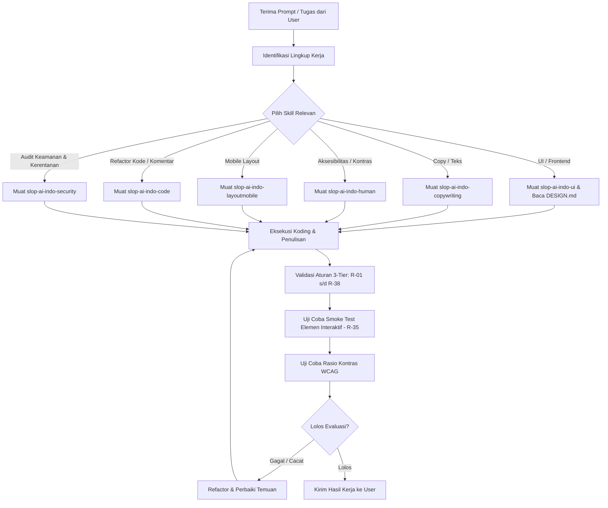

# WORKFLOW.md - Alur Kerja Operasional AI Coding Agent

Dokumen ini memandu langkah kerja harian agen coding dari penerimaan prompt hingga pengiriman kode yang bersih, aman, dan bebas dari AI slop.

---

## 1. Alur Kerja Standar (End-to-End Workflow)

---

## 2. Tahapan Detail Eksekusi

### Langkah 1: Klasifikasi Tugas & Pemilihan Skill
Sebelum menulis baris kode pertama, agen wajib mengidentifikasi domain pekerjaan:
- Jika membangun antarmuka web, SaaS, dashboard, atau form: Wajib membaca `DESIGN.md` untuk mengunci token kanvas terang, siku radius 4px-6px, dan palet warna.
- Jika menulis judul, pesan status, atau dokumentasi: Wajib mematuhi larangan kata-kata hiperbola AI (seperti *"revolusioner"*, *"seamless"*, atau *"game-changing"*).
- Jika melakukan audit keamanan, pengujian penetrasi defensif, atau review kerentanan kode/API: Wajib memuat `skills/slop-ai-indo-security/SKILL.md` untuk alur source-first, boundary verification, dan format temuan terstandarisasi.

### Langkah 2: Eksekusi Koding Bertahap (Clean Coding)
1. **Hindari Tombol & Badge Kapsul (*No Pill Buttons*):** Selalu gunakan `border-radius: 4px` atau `6px`.
2. **Hindari Pendaran Neon (*No Glowing Borders*):** Gunakan border garis tipis solid 1px (`#e2e8f0` untuk terang, `#27272a` untuk gelap).
3. **Tanpa Angka Metrik Rekayasa (*No Fake Metrics*):** Dilarang membuat teks statistik palsu seperti *"10,000% ROI"* atau rating statis *"5.0 bintang dari 100.000 pelanggan"*.
4. **Komentar Kode Minimalis:** Hapus komentar yang hanya mengulang fungsi nama variabel atau instruksi dasar.

### Langkah 3: Pengujian Interaktif (Smoke Test - R-35)
Agen wajib menguji setiap elemen yang dapat diklik atau diinput:
- Tombol aksi utama (Submit, Cancel, Delete).
- Form input dan validasi data (error message tampil dengan benar).
- Transisi status (Hover, Focus, Active, Disabled).

### Langkah 4: Pengujian Kontras Warna (WCAG AA)
Gunakan skrip pemeriksa kontras `skills/slop-ai-indo-human/contrast-check.py` untuk mengukur rasio:
- Teks biasa terhadap latar: minimal **4.5:1**.
- Teks tebal / besar terhadap latar: minimal **3.0:1**.

### Langkah 5: Verifikasi Akhir & Serah Terima
Sebelum menyerahkan hasil pekerjaan ke pengguna, agen memastikan bahwa:
- Seluruh elemen interaktif dan alur navigasi telah berfungsi normal.
- Tidak ada kata promosi generik AI atau klaim fiktif.
- Seluruh aturan wajib (R-01 s/d R-38) telah dipatuhi.
Setelah verifikasi selesai, agen langsung menyerahkan kode yang bersih dan siap digunakan tanpa perlu mencantumkan checklist laporan evaluasi yang panjang.
